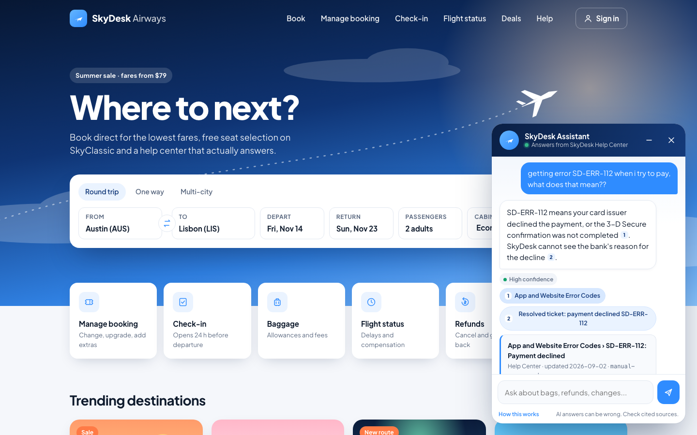
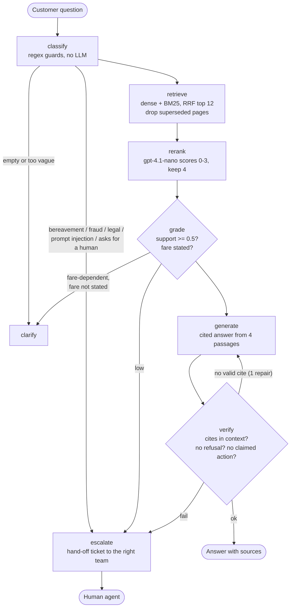

# SkyDesk Support Assistant

A customer-support RAG bot for SkyDesk, a fictional airline. It answers from the help center with citations, and hands the conversation to a human when it is not sure or when policy says a person must handle it.

## Week 2 submission

The Gen Academy, Week 2 "Build your RAG application". Track 2 (LangChain + LangGraph), suggested use case 4: Customer Support Knowledge Base with Hybrid Search, plus the bonus chatbot UI add-on.

| Deliverable | Where |
|---|---|
| Project documentation | [`docs/PROJECT_DOC.md`](docs/PROJECT_DOC.md) (submitted as a Google Doc via the form) |
| Video demo (5 minutes or less) | submitted via Google Drive (link in the submission form) |
| Project assets | this repository |
| Evaluation metrics document (use case 4) | [`docs/EVAL_REPORT.md`](docs/EVAL_REPORT.md) |
| Agent Report Card grade of the v5_final run log | [`eval/agent_report_card.md`](eval/agent_report_card.md) |

> **One-liner:** My RAG app helps SkyDesk support agents and customers answer booking, refund, baggage and policy questions from the SkyDesk help center (55 docs: policies, FAQs, app manual, resolved tickets) in a chat widget on the airline's website with **94% faithfulness** against a 90% target (15/16 answers, my manual review) and **4.06/5 relevance** (LLM judge), under a **3-second latency ceiling** (measured p95 1.78 s), and escalates to a human when it is not sure.

These numbers come from the final run, `v5_final`. With only 16 judged answers, the faithfulness interval is wide (Wilson 95% interval 0.72 to 0.99). The LLM judge gives 13/16 (81%), and it disagrees with my review on 4 of the 16. See [Evaluation](#evaluation).



## Quickstart

You need Python 3.11 or newer and an OpenAI API key.

```bash
git clone https://github.com/ajayvnkt/skydesk-support-rag.git
cd skydesk-support-rag
python3 -m venv .venv
.venv/bin/pip install -r requirements.txt
echo "OPENAI_API_KEY=<your-openai-key>" > .env        # .env is gitignored

.venv/bin/python -m pytest -q                   # 101 tests, never call the API
.venv/bin/python -m rag index                   # embeds 206 chunks once, about $0.0005
.venv/bin/python -m rag ask "What does SD-ERR-112 mean?"
.venv/bin/python -m rag cost                    # spend so far, by purpose

.venv/bin/uvicorn server:app --port 9006        # airline site + docked chat: http://localhost:9006
.venv/bin/streamlit run app.py --server.port 9007   # ops console: http://localhost:9007
```

- **Customer site.** The site on 9006 (`web/`, plain HTML/CSS/JS, no build step) is a mock airline homepage with the SkyDesk Assistant docked bottom right.
  - Help buttons (Baggage, Refunds, Flight status and so on) open the chat with a question filled in.
  - `server.py` (FastAPI) exposes `POST /api/ask`, `GET /api/cost`, `GET /api/log` (this browser session's run log) and `GET /api/health`.
  - The page makes no model calls until you send a message.
- **Ops console.** The console on 9007 has a chat with a retrieval-mode switch and per-turn traces, an Evaluation page that reads `eval/results.json`, and a How it works page.

Re-run the evaluation (about $0.010 with the ablation) with `.venv/bin/python eval/run_eval.py --tag v5_final`, or recompute metrics offline with `--rescore`.

## Architecture

| Field | SkyDesk |
|---|---|
| **Corpus** | 55 English docs, about 14,800 words: 24 policies, 9 FAQs, 9 app-manual pages and 13 resolved tickets. 50 are Markdown with YAML front-matter and 5 are raw HTML pages. One superseded 2024 policy stays in for the freshness test. |
| **Ingestion + cleaning** | `rag/ingest.py` reads the front-matter (id, doc_type, updated, tags) and parses HTML with the standard-library parser. It drops scripts, nav, footer and the cookie banner, decodes entities, and keeps table cells apart. |
| **Freshness** | Embeddings are cached by content hash, so re-indexing only pays for changed chunks, and a policy edit is live on the next index run. Superseded pages are dropped before reranking when a current page exists. |
| **Chunking + embedding** | Docs are split on headings first, and the heading becomes the cited section. Long sections are then cut to about 350 tokens with 50 overlap. That gives 206 chunks, embedded with `text-embedding-3-small`. |
| **Retrieve** | Dense cosine search (top 20) and BM25 with code-aware tokens like `SD-ERR-112` (top 20) are fused with Reciprocal Rank Fusion into 12 candidates. `gpt-4.1-nano` reranks them from 0 to 3 and keeps 4. |

One support turn is a LangGraph `StateGraph` ([`rag/graph.py`](rag/graph.py)) with 8 nodes:



**LangChain primitives used:** `Document` for chunks; `RecursiveCharacterTextSplitter` for chunking; a custom `HybridRetriever(BaseRetriever)` for retrieval; and `ChatPromptTemplate` for all five prompts (generate, repair, rerank, price check, judge, in [`rag/prompts.py`](rag/prompts.py)).

Model calls deliberately go through [`rag/llm.py`](rag/llm.py) rather than `ChatOpenAI`, so that every call passes the cost ledger and the $1.00 hard cap. `gpt-4.1-mini` runs a price self-check, but only when an answer quotes prices from a per-fare table.

| File | What it does |
|---|---|
| `rag/llm.py` | The only module that calls OpenAI: cost ledger in `store/cost_ledger.json`, hard $1.00 cap (`BudgetExceeded`), embedding cache |
| `rag/ingest.py` | Loads Markdown and HTML, cleans it, chunks it |
| `rag/index.py` | Dense + BM25 + RRF, with modes `hybrid`, `dense` and `bm25`; `HybridRetriever` |
| `rag/rerank.py` | One listwise rerank call per question |
| `rag/prompts.py` | All prompts as `ChatPromptTemplate`s |
| `rag/graph.py` | The LangGraph flow, guards, confidence and citation checks |
| `rag/pipeline.py` | `ask(query)`: runs the graph and writes a run-log line |
| `server.py`, `web/` | Airline site + chat API (port 9006) |
| `app.py` | Streamlit ops console (port 9007) |
| `eval/run_eval.py` | 20-query eval, retrieval ablation, LLM judge, threshold sweep |

## Evaluation

The eval set is 20 support queries in [`eval/queries.yaml`](eval/queries.yaml): answerable, multi-doc, exact error codes, ambiguous, unanswerable and must-escalate. The full write-up is in [`docs/EVAL_REPORT.md`](docs/EVAL_REPORT.md).

| Metric | v5_final | v4_final |
|---|---|---|
| Routes correct (answer / escalate / clarify) | **19/20** | 18/20 |
| First-contact resolution, manual review | **12/16** | 14/16 |
| First-contact resolution, judge / exact key-fact text | 10/16 / 10/16 | 11/16 / 9/16 |
| Escalation precision / recall | **1.00 / 1.00** | 1.00 / 1.00 |
| Unanswerable refused; must-escalate caught | 2/2; 2/2 | 2/2; 2/2 |
| Faithfulness, manual review | **15/16 (93.8%)** | 14/16 |
| Faithfulness, LLM judge | 13/16 (81%), score 0.844 | 14/16 |
| Relevance (judge, 1-5) | 4.06 | 4.5 |
| Valid citations / cites an expected doc | 100% / 94% | 100% / 94% |
| Latency p50 / p95 | 1.50 s / 1.78 s | 1.51 s / 2.17 s |
| Cost per query | $0.000265 | $0.00025 |

**Retrieval ablation (14 queries, hit@4 / MRR):**

| Retriever | hit@4 | MRR |
|---|---|---|
| Dense only | 1.00 | 0.810 |
| BM25 only | 0.714 | 0.550 |
| Hybrid | 1.00 | 0.655 |
| Hybrid + rerank | 1.00 | 0.839 |

**Threshold.** The 0.5 threshold sits in a flat best range from 0.40 to 0.55.

**What still fails:**

- **q05.** A pet question was answered with "which fare are you on?", because the baggage fare table tied at the top of the ranking.
- **q09.** It gives no price when the fee table isn't retrieved (1 of the 2 v5 eval runs).
- **q10 (unfaithful).** It says the travel credit expires under the SkyMiles 24-month rule; the correct answer is 12 months.
- **q11.** It leaves out that taxes and airport fees are refundable.

The v4 to v5 differences are one or two queries out of 20, too few to call either version better.

## Checked with Agent Report Card

I also graded the v5_final run log with Agent Report Card, the tool I built in Week 1. The report is in [`eval/agent_report_card.md`](eval/agent_report_card.md).

| Tool | What it checked | Result |
|---|---|---|
| Agent Report Card | Behaviour grade of the v5_final run log | 0 critical findings, 89% predicted success, rung "Human approves"; it cannot judge answers (q05 98%, q10 99%) |

Only my manual review caught q10's wrong expiry date; the LLM judge and the Report Card both passed it.

## Cost

Every OpenAI call is logged in `store/cost_ledger.json` and refused once spend would pass $1.00.

| | USD |
|---|---|
| Whole project, all runs: build, eval runs, UI, QA and live test runs | **$0.107668** (before the demo video; $0.1139 in total with the video recording) of the $1.00 cap (755 calls) |
| By purpose | rerank $0.0620, generate $0.0290, judge $0.0100, price check $0.0056, citation repair $0.0005, embeddings $0.0005 |
| Per question, v5_final | **$0.000265**; guard escalations cost $0 |

At that rate, 1,000 questions cost about $0.26.

## Limitations

- **Small, self-graded eval.** Every fix was tuned on the same 20 queries, with no held-out set, so the numbers are probably optimistic. Only two unanswerable queries calibrate the 0.5 threshold.
- **The judge is lenient in places.** It passed q10's wrong credit expiry, and it disagrees with my review on 4 of 16 answers.
- **Known misses:** q05, q09, q10 and q11 (above).
- **Regex guards** catch the injection and policy phrasings I tested, not every rewording. The claimed-action check in `verify` is the second layer.
- **Off-topic questions** escalate to a human instead of getting a polite redirect.
- **English only.** The suggested use case mentions multilingual retrieval, which this corpus does not test.
- **In-memory index** (206 chunks). A larger help center needs a real vector store.
- **Synthetic data.** The corpus, tickets and policies were written for this project.

## License

MIT, see [LICENSE](LICENSE).
