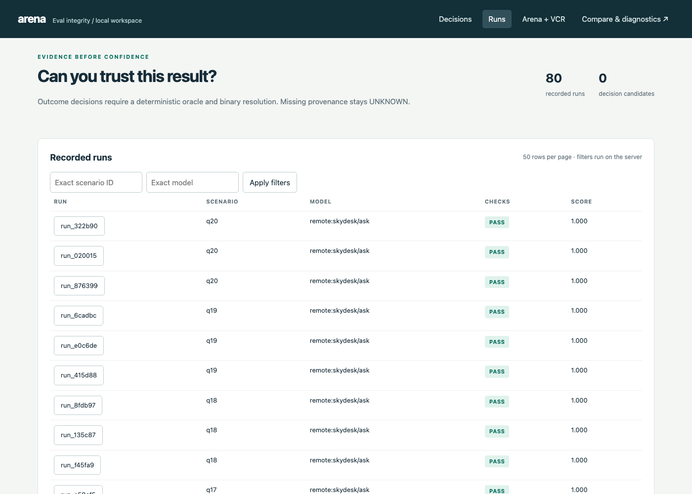

# Validation with my own tools

I checked the v5 SkyDesk bot with four tools I built in earlier weeks. Each covers a different part:

| Tool | What it checks | Uses the API? | Result on v5 |
|---|---|---|---|
| [Agent Arena](#1-agent-arena-live-scenario-tests-x-3) | 20 live scenarios x 3 repeats, deterministic checks on route, retrieved doc, key fact, errors, latency | yes, $0.0182 | **56/60 (93.3%)**, mean score 0.99; 17/20 scenarios 3/3; flaky q09 (1/3), q08 (2/3), q11 (2/3) |
| [EvalKit](#2-evalkit-statistics-on-v5_final) | Wilson intervals, calibration of the new confidence, exact McNemar v0/v4 vs v5 | no | route 0.95 [0.76, 0.99]; v4 to v5 p = 1.0, v0 to v5 p = 0.22: **not significant**; ECE 0.24 to 0.15 |
| [Agent VCR](#3-agent-vcr-tool-call-snapshot-tests) | Tool-call sequence vs golden traces, subsequence and exact, 2 negative controls | no | v5_final 20/20 exact; Arena 20/20 exact; both negative controls fail as designed; v5_rc1 fails exact on 3 |
| [Agent Report Card](#4-agent-report-card-week-1-grader) | Behaviour grade of the `v5_final` run log, no ground truth | no | 0 critical findings, 89% predicted success, "Human approves" rung |

None of the four replaces the manual faithfulness review in [EVAL_REPORT.md](EVAL_REPORT.md). The one unfaithful v5 answer (q10, wrong credit expiry) passed all four tools.

---

## 1. Agent Arena: live scenario tests x 3

**What it checks.** Arena runs the real bot. [`arena/adapter.py`](../arena/adapter.py) calls `python -m rag ask "<q>" --json` in this project's venv and reports two synthetic tool calls: `route` (`{route, confidence, reason}`) and `search_kb` (doc ids of the context chunks, including a pinned fare row, plus citations; absent on the guard path). [`arena/scenarios/qNN.yaml`](../arena/scenarios) has one scenario per eval query: the expected route (weight 2), for answer queries the first expected doc and one key fact (`final_regex` for q14), q09's `final_not_contains "$100"`, `no_errors` and `max_latency_ms 15000`. No LLM judge, so Arena itself costs nothing beyond the bot calls. Scenarios were not changed for v5.

```bash
: > /Users/vnktajay/Projects/skydesk-support-rag/logs/conversations.arl.jsonl    # Arena-only log
cd /Users/vnktajay/Projects/agent-arena-build
.venv/bin/arena run /Users/vnktajay/Projects/skydesk-support-rag/arena --repeat 3 --min-pass-rate 0 \
    --store /Users/vnktajay/Projects/skydesk-support-rag/arena/.arena
cp /Users/vnktajay/Projects/skydesk-support-rag/logs/conversations.arl.jsonl \
   /Users/vnktajay/Projects/skydesk-support-rag/logs/arena_v5.arl.jsonl
# dashboard (already running on 9002, reads the store live):
nohup .venv/bin/arena serve --port 9002 --store /Users/vnktajay/Projects/skydesk-support-rag/arena/.arena \
    --project /Users/vnktajay/Projects/skydesk-support-rag/arena &
```

**Result: 56/60 pass (93.3%), mean score 0.99, $0.0182 for 60 live calls, 1.6-11.2 s each** (the subprocess reloads the index every call). Console output: [`arena/last_run.txt`](../arena/last_run.txt).

| Scenario | Pass | Notes |
|---|---|---|
| q01-q07, q10, q12-q14 | 3/3 each | q03 and q06 no longer escalate (they failed in the v4 Arena run with `no_citations`) |
| q05 | 3/3 | answered "$95 each way, 8 kg" every time; the eval run instead asked for the fare (see below) |
| q08 | 2/3 | the failure is a check artifact: the path was paraphrased ("your profile, then personal details, and contact information"), answer correct |
| **q09** | **1/3** | the run with `policy-baggage-fees` in context answered $40 (price check fired); the other two gave no price ("appears when you tap to add it" / "an agent must verify"). No run said $100 |
| **q11** | **2/3** | the failing run says "you cannot cancel it for a refund" without "non-refundable" or the tax refund. One passing run has wrong reasoning ("does not meet the 7-day advance requirement") that the literal check can't see |
| q15, q16 | 3/3 | route `clarify` (v4: 0/1) |
| q17, q18, q19, q20 | 3/3 | escalations, guards in ~1.6 s including process start |

**Flakiness.** 3 of 20 scenarios are flaky (q08, q09, q11); 17 are stable. Tool sequences were identical across all 3 repeats of every scenario (checked from the ARL log), so the flakiness is all in reranker scores and generation, not in control flow. Across the 80 live v5 runs (20 eval + 60 Arena), q05 was routed to clarify once and answered 3 times: the eval run hit the rare case, Arena didn't.

**What this adds.** Repeats turn single-run anecdotes into rates: q09's "fixed" is really 1 in 4. It also confirms the citation-format failure is gone at 0/60. It missed q10's wrong expiry (its check only looks for "$100").

**Screenshots** (fresh, Playwright against http://127.0.0.1:9002, 80 recorded runs = 20 from v4 + 60 from v5):

- `docs/images/arena_run.png`: the runs table
- `docs/images/arena_run_q09.png`: evidence for the failing q09 repeat `run_b98ba3e045`



## 2. EvalKit: statistics on v5_final

**What it checks.** [`eval/evalkit_check.py`](../eval/evalkit_check.py) reads `eval/results.json` and writes [`eval/evalkit_results.json`](../eval/evalkit_results.json): Wilson intervals; ECE (5 equal-width bins), Brier and AUROC of a score against `route_correct` (guard runs have no score, n = 18); exact McNemar plus a Newcombe paired interval on `route_correct` for v0 vs v5 and v4 vs v5. No API calls.

```bash
PYTHONPATH=/Users/vnktajay/Projects/evalkit/src .venv/bin/python eval/evalkit_check.py
```

| Metric | Value | 95% interval |
|---|---|---|
| Route accuracy | 19/20 = 0.95 | Wilson [0.764, 0.991] |
| FCR, manual review | 12/16 = 0.75 | Wilson [0.505, 0.898] |
| FCR, strict literal | 10/16 = 0.625 | Wilson [0.386, 0.815] |
| Faithfulness, manual | 15/16 = 0.938 | Wilson [0.717, 0.989] |
| v0 to v5, routes | 15 to 19 (gains q03, q06, q15, q16, q18; loss q05) | exact McNemar **p = 0.219**; Newcombe [-0.046, +0.428] |
| v4 to v5, routes | 18 to 19 (gains q15, q16; loss q05) | exact McNemar **p = 1.0**; Newcombe [-0.155, +0.258] |

| Calibration (n = 18) | ECE | Brier | AUROC |
|---|---|---|---|
| v5 `confidence` (P(route right)) | **0.151** | **0.091** | 0.50 (1 negative) |
| v5 `support` (gate score) | 0.220 | 0.157 | 0.44 |
| v4 `confidence` | 0.239 | 0.208 | 0.125 (2 negatives) |

**What the numbers say**

- **Nothing between versions is significant at n = 20.** v4 to v5 is 2 gains and 1 loss. Even v0 to v5 (5 gains, 1 loss) gives p = 0.22. The claim "v5 routes better" is directional only.
- **The confidence redefinition worked on what it targeted.** ECE and Brier drop because correct escalations now score high (q17 0.96, q18 0.65) instead of near 0. In v4 every bin below 0.8 had accuracy 1.0 with a large negative gap; now the remaining gap is under-confidence on correct answers at 0.6-0.8.
- **It still can't flag its own clarify mistakes.** The only wrong route (q05) has confidence 0.96, because the clarify rule and the confidence read the same retrieval evidence. AUROC with one negative is not a meaningful number.

## 3. Agent VCR: tool-call snapshot tests

**What it checks.** [`eval/arl_to_vcr.py`](../eval/arl_to_vcr.py) turns an ARL log into VCR traces (`{version: 1, scenario, calls: [{name, args}]}`) from `tool_call` events, matching runs to eval ids by query text (last run wins), and writes golden traces from `eval/queries.yaml`:

| Expected behaviour | Golden trace |
|---|---|
| answer, clarify | `search_kb -> rerank_kb` |
| unanswerable (low-support escalate) | `search_kb -> rerank_kb -> escalate_to_human` |
| must_escalate (guard) | `escalate_to_human` |

Args are reduced to `{query}`.

```bash
.venv/bin/python eval/arl_to_vcr.py logs/v5_final.arl.jsonl actual
.venv/bin/python eval/arl_to_vcr.py logs/arena_v5.arl.jsonl actual_arena
.venv/bin/python eval/arl_to_vcr.py logs/v5_rc1.arl.jsonl actual_v5_rc1
VCR="node /Users/vnktajay/Projects/agent-vcr-build/dist/cli.js"
$VCR validate vcr/expected/q01.json
$VCR diff vcr/expected/q01.json vcr/actual/q01.json --mode subsequence
$VCR diff vcr/expected/q01.json vcr/actual/q01.json --mode exact
$VCR diff vcr/expected/q17.json vcr/negative/neg_q17_no_escalation.json --mode exact   # must exit 1
$VCR diff vcr/expected/q19.json vcr/negative/neg_q19_guard_bypassed.json --mode exact  # must exit 1
```

(In zsh, call the CLI through a function or write it out; `$VCR` with spaces doesn't word-split. The full loop is what produced `vcr/results.tsv`.)

**Golden traces: unchanged, deliberately.** I checked each v5 flow change against what VCR sees:

- **Citation repair** is a second `generate` LLM call (`llm_response` with `purpose: generate_repair`), not a tool call, so the tool sequence is unchanged. It fired in 0 of 80 v5_final/Arena runs.
- **Per-fare clarify** happens in `grade` after `search_kb -> rerank_kb`, with no tool of its own: same golden as before.
- **Pinned fare row** and the **price check** happen inside `rerank_kb` and `generate`.

So no golden trace needed updating. Regenerating `vcr/expected/` from `queries.yaml` produced byte-identical files (checked with `diff -r`).

| Trace set | validate | diff subsequence | diff exact |
|---|---|---|---|
| expected + 3 actual sets + 2 negatives (82 files) | 82/82 | | |
| `actual/` (v5_final) | | 20/20 | **20/20** |
| `actual_arena/` (Arena, last repeat; all 3 repeats share one sequence per query) | | 20/20 | **20/20** |
| `actual_v5_rc1/` (pre-parser-fix run) | | 20/20 | **17/20**: q06, q10, q14 have an extra `escalate_to_human` |

**Negative controls** (hand-mutated copies of real traces, same query, in `vcr/negative/`):

| Control | Mutation | subsequence | exact |
|---|---|---|---|
| `neg_q17_no_escalation` vs expected q17 | escalation dropped (bot answered an out-of-KB question) | exit 1: "expected call 2 (escalate_to_human) not found" | exit 1: length 3 vs 2 |
| `neg_q19_guard_bypassed` vs expected q19 | bereavement went through retrieval and was answered | exit 1: "escalate_to_human not found" | exit 1: length 1 vs 2 |

Both fail as they must. (The v4 controls compared different queries, so they also failed on the `query` arg; these differ only in tool sequence.)

**What this adds, and what it can't see**

- **Exact mode is required.** v5_rc1's spurious escalations pass subsequence mode, because `search_kb -> rerank_kb` is a subsequence of the escalated trace. Only exact mode catches them.
- **Tool traces can't see answer vs clarify, or the repair turn.** q05's wrong clarify passes VCR. Snapshotting `llm_response` purposes as well would make the repair turn visible; I didn't add that.

Full table: [`vcr/results.tsv`](../vcr/results.tsv).

## 4. Agent Report Card (Week 1 grader)

**What it checks.** The Week 1 tool grades any ARL log with its generic policy and trained success model, without ground truth or API calls. Output: [`eval/agent_report_card.md`](../eval/agent_report_card.md).

```bash
cd /Users/vnktajay/Projects/agent-report-card
.venv/bin/python -m arc analyze /Users/vnktajay/Projects/skydesk-support-rag/logs/v5_final.arl.jsonl \
    --out /Users/vnktajay/Projects/skydesk-support-rag/eval/agent_report_card.md
```

| Measure | v5_final | v4_final |
|---|---|---|
| Runs, log format | 20 runs, 195 events, ARL detected at 0.98 | 20, 198 |
| Agent said "done" | 65% (13 answered; clarify counts as not done) | 80% |
| Critical findings / "said done but failed" | 0 / 0 | 0 / 0 |
| Mean predicted success | 89% | 89% |
| Autonomy rung | Human approves (below 90%) | same |
| Cost | $0.0054 total, $0.0003 per run | $0.0052 |

**What the numbers say.** The behaviour grade is clean: no false "done", no failed tools, cost right. But it doesn't check answers. It again ranks the two correct not-in-KB escalations (q17, q18) as the likeliest failures at 1%, and gives q05 (wrong clarify) 98% and q10 (unfaithful) 99%. It is a cheap behaviour linter, not an accuracy measure. Its 89% lands between the manual FCR (75%) and manual faithfulness (94%), but nothing in the method ties it to either.

---

## Spend

Ledger $0.072242 to $0.107668 (+$0.0354) for this whole validation: v5_rc1 eval $0.0102, v5_final eval $0.0070, Arena 60 runs $0.0182. EvalKit, VCR and Report Card use no API. `pytest -q`: 101 passed, no API calls.

## Files

| Path | Purpose |
|---|---|
| `arena/agent.yaml`, `arena/adapter.py`, `arena/scenarios/q01-q20.yaml` | Arena project |
| `arena/.arena/` | Arena run store (80 runs); local only, gitignored. The run summary is kept in `arena/last_run.txt` and `arena/evidence/diagnosis.json` |
| `arena/last_run.txt` | console output of the 3-repeat run |
| `logs/v5_final.arl.jsonl`, `logs/v5_rc1.arl.jsonl`, `logs/arena_v5.arl.jsonl` | ARL logs of the eval runs and the Arena repeats |
| `docs/images/arena_run.png`, `docs/images/arena_run_q09.png` | dashboard screenshots |
| `eval/evalkit_check.py`, `eval/evalkit_results.json` | EvalKit script and output |
| `eval/arl_to_vcr.py` | ARL to VCR converter |
| `vcr/expected/`, `vcr/actual/`, `vcr/actual_arena/`, `vcr/actual_v5_rc1/`, `vcr/negative/` | golden, actual and negative-control traces |
| `vcr/results.tsv` | VCR pass/fail table |
| `eval/agent_report_card.md` | Report Card output for `v5_final` |
